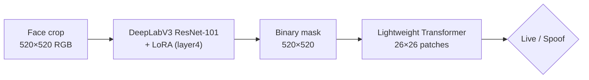

# DEEPFAS: Face Anti-Spoofing with LoRA-Adapted DeepLabV3 Masks and a Lightweight Transformer

Official code for the paper **"PAPER TITLE"**.

The pipeline decides whether a face image is **live** (bona fide) or a **spoof** (presentation attack) in two stages:

1. A pre-trained **DeepLabV3 (ResNet-101)**, adapted with **LoRA**, predicts a binary mask: the face region for live samples, an empty mask for attacks.
2. A **lightweight Transformer** classifies the predicted mask as live or spoof.

Because the classifier only sees the predicted mask, every decision can be inspected through that mask.



## Method

| Step | What happens | Code |
|---|---|---|
| 1. Training masks | Live images: foreground predicted by the pre-trained DeepLabV3 (torchvision `COCO_WITH_VOC_LABELS_V1` weights). Attack images: all-black mask. | `engine.create_masks` |
| 2. LoRA fine-tuning | LoRA (r = 32, α = 64) on the 3×3 `conv2` of the three bottleneck blocks of `layer4`; new 1×1 output convolution with sigmoid; all other weights frozen (491,777 trainable parameters). MSE loss, Adam (lr 1e-4), batch 28, 20 epochs. The final-epoch model is used. | `models.ModifiedDeepLabV3_DeepLoRA`, `engine.fine_tune_model` |
| 3. Binary maps | Output of the fine-tuned model binarized at 0.5. The classifier uses only these predicted maps. | `engine.create_feature_maps` |
| 4. Classifier | Patch size 20 (676 tokens), embedding 128, 2 pre-norm encoder layers, 4 heads, MLP 256, dropout 0.1, average pooling, MLP head (469,250 parameters). Cross-entropy, AdamW (lr 1e-4, weight decay 1e-4), batch 28, 15 epochs. | `models.BinaryMapTransformer`, `engine.train_classifier` |
| 5. Evaluation | Accuracy, FAR / FRR / HTER, AUC, APCER / BPCER / ACER; PCA, t-SNE and UMAP plots of the classifier embeddings (input of its last linear layer) on the test set. | `engine.evaluate_classifier`, `engine.extract_embeddings`, `utils.plot_dimensionality_reduction` |

All values are set in [`configs/default_config.yaml`](configs/default_config.yaml).

## Repository structure

```
.
├── configs/
│   └── default_config.yaml       # hyperparameters used in the paper
├── notebooks/
│   ├── anti-spoofing-pipline.ipynb   # the same pipeline as a single Kaggle notebook
│   └── anti_spoofing_pipline.py      # the notebook as a plain script
├── src/
│   ├── config.py                 # configuration dataclasses + YAML loading
│   ├── data.py                   # image collection, round-robin sampling, dataset, loaders
│   ├── engine.py                 # mask creation, fine-tuning, maps, classifier, metrics
│   ├── models.py                 # LoRA layer, DeepLabV3-LoRA, Transformer classifier
│   ├── transforms.py             # resizing / normalization
│   └── utils.py                  # checkpoints, plots, seeding
├── tests/                        # unit tests (pytest)
├── run_pipeline.py               # command-line entry point
├── requirements.txt
└── LICENSE
```

## Installation

```bash
git clone https://github.com/GITHUB_USER/REPOSITORY.git
cd REPOSITORY
pip install -r requirements.txt
```

Python 3.10 or newer. A CUDA GPU is strongly recommended (the experiments were run in Kaggle GPU notebooks). The pre-trained DeepLabV3 weights are downloaded by torchvision on the first run.

## Datasets

The datasets are not redistributed here. Request them from their owners and follow their license agreements:

| Dataset | Reference |
|---|---|
| Replay-Attack | Chingovska, Anjos, Marcel, BIOSIG 2012 — [Idiap Research Institute](https://www.idiap.ch/en/dataset/replay-attack) |
| MSU-MFSD | Wen, Han, Jain, IEEE TIFS 2015 |
| CASIA-FASD | Zhang et al., ICB 2012 |
| OULU-NPU | Boulkenafet et al., FG 2017 |

**Input format.** The pipeline starts from cropped face images: the frames of each video are stored as `cropped_<k>.jpg` in one folder per video. Frame extraction and face cropping are not part of this repository.

**Folder names** encode the official partition and the class, separated by underscores:

```
<dataset>_<split>_<class>_<anything>      e.g.  replay_train_live_client001_session01
```

- `<split>`: `train` or `test`. Other partitions (e.g. `devel`) are ignored.
- `<class>`: `live` for bona fide videos; any other value is treated as an attack.

The video folders can be at any depth below the dataset root, for example:

```
data/replay-attack/
└── faces/
    ├── train/
    │   ├── replay_train_live_client001_session01/cropped_0.jpg ...
    │   └── replay_train_attack_print_client001_.../cropped_0.jpg ...
    └── test/
        └── replay_test_live_client003_session01/cropped_0.jpg ...
```

## Usage

**Full pipeline** (masks → fine-tuning → maps → classifier → evaluation):

```bash
python run_pipeline.py --config configs/default_config.yaml \
    --data data/replay-attack --output results/replay-attack
```

**On Kaggle:**

```bash
!git clone https://github.com/GITHUB_USER/REPOSITORY.git
%cd REPOSITORY
!python run_pipeline.py --data /kaggle/input/<your-dataset> --output /kaggle/working/results
```

Alternatively, open `notebooks/anti-spoofing-pipline.ipynb` on Kaggle and set `BASE_PATH` and `OUTPUT_ROOT` in its configuration cell.

**Running steps separately.** The sampled image lists are saved in `<output>/splits/` and reused by later runs with the same output folder, so the steps can be run one at a time:

```bash
python run_pipeline.py --output results/replay-attack --data data/replay-attack --steps masks finetune
python run_pipeline.py --output results/replay-attack --data data/replay-attack --steps maps classify
```

`maps` without `finetune` loads `<output>/checkpoints/Epoch-20.pth.tar`, or the file given with `--segmentation-checkpoint`. Use `--resample` to draw new image lists, `--seed N` for a seeded run and `--device cpu|cuda` to choose the device.

**Cross-dataset setting.** With several roots, e.g. `--data data/msu data/replay-attack`, the last root is used for testing and the others for training. This option is not used for the results in the paper (all reported experiments are intra-dataset).

## Outputs

Everything is written to the output folder:

| File | Content |
|---|---|
| `metrics.json` | all results of the run (segmentation, classifier, run times) |
| `classifier_metrics.json` | Accuracy, FAR, FRR, HTER, AUC, APCER, BPCER, ACER |
| `segmentation_metrics.json` | test IoU and pixel-level AUC of the fine-tuned DeepLabV3 |
| `training.csv`, `loss-function-train-validation-deeplabv3.{png,pdf}` | fine-tuning history |
| `classifier_training.csv` | classifier training loss and accuracy per epoch |
| `transformer_roc_curve.png`, `finetuned-deeplabv3-roc.png` | ROC curves |
| `BinaryMapTransformer_{PCA,tSNE,UMAP}.png` | 2-D projections of the classifier embeddings (test set) |
| `images-masks-finetuned.{png,pdf}` | example images with true and predicted masks |
| `checkpoints/` | `Epoch-20.pth.tar` (fine-tuned DeepLabV3, final epoch), `transformer_classifier.pth` |
| `splits/` | the sampled train / test image lists |
| `<…>/mask_*.png`, `<…>/map_*.png` | training masks and binary maps predicted by the fine-tuned DeepLabV3, mirroring the input folders |
| `config_used.yaml` | the configuration of the run |

## Evaluation protocol and reproducibility notes

- **Partitions.** The official train and test partitions of each dataset are used (intra-dataset protocol).
- **Sampling.** 4,200 images are sampled per dataset, 3,150 from the training partition and 1,050 from the test partition, taking one image per video folder in turn (round-robin) so that all videos are represented.
- **Metrics** are computed per image. FAR, FRR and HTER use the argmax prediction; APCER, BPCER and ACER use P(live) ≥ 0.5. No threshold is tuned. With live = 1 and attack = 0, APCER = FAR and BPCER = FRR, so ACER equals HTER except for exact ties at 0.5.
- **Fine-tuning schedule.** DeepLabV3 is fine-tuned for a fixed 20 epochs, without early stopping. After every epoch the IoU is computed on the test partition (there is no separate validation split, as in the reported experiments) and drives the learning-rate decay: lr × 0.5 when 0.95 < IoU < 0.955, lr × 0.1 when IoU > 0.955.
- **Final model.** The fine-tuned DeepLabV3 used for the maps is the model after epoch 20, saved as `checkpoints/Epoch-20.pth.tar`. No other checkpoint is saved or selected.
- **Randomness.** `seed: null` (default) leaves the run unseeded, as in the reported experiments, so the sampled images and the initialization differ between runs. Set `seed` for repeatable sampling and initialization (some GPU operations may still be non-deterministic). t-SNE and UMAP use `random_state=42`.

## Tests

```bash
python -m pytest
```

The tests use randomly initialized networks and need no dataset or weight download.

## Citation

If you use this code, please cite:

```bibtex
@article{KEY,
  author  = {AUTHORS},
  title   = {PAPER TITLE},
  journal = {JOURNAL},
  year    = {YEAR},
  doi     = {DOI}
}
```

## License

The code is released under the [MIT License](LICENSE). The datasets and the pre-trained DeepLabV3 weights are subject to their own licenses.
